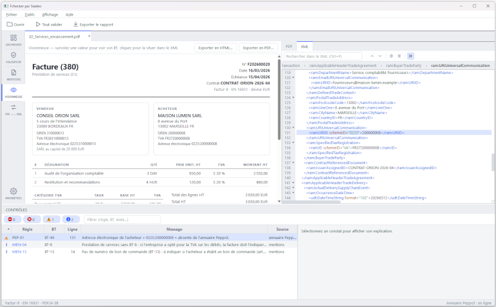

# Fchecker

Application desktop pour **contrôler des factures électroniques** dans le cadre de la réforme
française de la facturation électronique (2026-2027). Formats pris en charge : Factur-X (PDF/A-3 + XML),
UN/CEFACT CII et UBL 2.1.



Glissez une facture dans la fenêtre, appuyez sur **F5** : chaque anomalie est localisée dans le XML et
expliquée en français, avec un exemple de correction.

## Fonctionnalités

| Outil | Ce qu'il vérifie |
|---|---|
| **Validateur** | Profil (EN 16931, EXTENDED-CTC-FR, BASIC WL…) · structure XSD · schematrons EN 16931 et Factur-X · règles françaises BR-FR (socle de la réforme) · PDF/A-3 et Factur-X (contrôle structurel) · identifiants (Luhn SIREN/SIRET, clé TVA FR, IBAN, BIC) · annuaire Peppol (adresse électronique du destinataire inscrite pour le format de la facture ; SMP et types de documents qu'il accepte) |
| **Traduction des erreurs** | Intégrée à tous les contrôles : code de règle (ex. `BR-CO-15`) → explication en français, champ BT, ligne XML, exemple de correction. Recherche d'un code sans document : Ctrl+Maj+R. |
| **Mentions obligatoires** | Check-list de 15 mentions (catégorie d'opération, SIREN client, adresse de livraison, option TVA sur les débits, pénalités, indemnité de 40 €, escompte, autoliquidation, franchise en base, mandat de facturation…), alignée sur le socle de la réforme et les exemples officiels FNFE |
| **Cohérence PDF ↔ XML** | N° de facture, dates, totaux HT / TVA / TTC, net à payer et SIREN : égalité exacte, formats d'affichage usuels acceptés. Double-clic sur un écart pour le surligner dans le PDF. |
| **Visionneuse** | Rendu lisible d'un XML CII ou UBL, avec le code BT au survol de chaque valeur, et export HTML / PDF |
| **Rapport** | Export PDF, HTML ou JSON de tous les résultats (Ctrl+E) |

## Référentiels embarqués

Les contrôles fonctionnent **hors ligne**. Seul l'annuaire Peppol nécessite le réseau.

- **Schematrons FNFE-MPE** (socle minimum de la réforme). Les versions et dates de chaque référentiel figurent dans l'écran Paramètres. Ils comprennent :
  - les règles EN 16931 ;
  - les règles françaises BR-FR, en version standard « fatal » ;
  - EXTENDED-CTC-FR ;
  - Factur-X ;
  - les XSD CII D22B et UBL 2.1.
- **Textes des règles** : traduction française des règles EN 16931 réalisée pour Fchecker à partir des messages anglais des artefacts CEN (le texte original reste consultable) ; règles de gestion G de l'annexe 7 des spécifications externes DGFiP v3.2.
- **Annuaire Peppol** : interrogé en ligne (directory.peppol.eu), désactivable dans les Paramètres.

## Installation

**Utilisateurs** : téléchargez `Fchecker-<version>-win64.zip` depuis la page
[Releases](https://github.com/serialiser/Fchecker/releases), décompressez-le dans un dossier où vous avez
le droit d'écrire (Documents, Bureau… les réglages sont enregistrés dans `settings.json`, à côté de
l'exécutable) et lancez `Fchecker\Fchecker.exe`. Aucune installation, ni Python, ni Java requis
(Windows 10/11, 64 bits).

**Depuis les sources** : Windows, Python 3.12 ou plus récent. Aucune dépendance Java.

```powershell
python -m venv venv
venv\Scripts\python -m pip install -e .[dev]
venv\Scripts\python main.py
```

Une ou plusieurs factures peuvent être passées en argument : `venv\Scripts\python main.py facture.pdf`.

## Utilisation

1. Ouvrez une facture : glisser-déposer, **Ctrl+O** ou fichiers récents.
2. Lancez tous les contrôles avec **F5**.
3. Consultez le panneau **Problèmes** (en bas) :
   - un clic sur un constat affiche son explication ;
   - un double-clic amène à la ligne XML, ou à la valeur dans le PDF.
4. Passez d'un outil à l'autre avec la barre de gauche ou **Ctrl+1…5**.

| Raccourci | Action |
|---|---|
| Ctrl+O / Ctrl+W | Ouvrir / fermer une facture |
| F5 | Tout valider |
| Ctrl+E | Exporter le rapport |
| Ctrl+Maj+R | Règles |
| Ctrl+J / Ctrl+K | Afficher le panneau Problèmes / le volet PDF-XML |
| Ctrl+, | Paramètres (annuaire Peppol, cache, référentiels) |

## Niveaux de gravité

- **Bloquant** : fichier inexploitable (PDF chiffré, aucun XML embarqué…).
- **Erreur** : obligation certaine, vérifiable sur la facture. Une plateforme agréée rejettera la facture.
- **Avertissement** : obligation conditionnelle ou incohérence probable, à examiner.
- **Information** : contrôle non effectué (réseau…), rappel d'une règle que la norme juge « non contrôlable
  automatiquement », ou résultat positif.

## Limites

- Le contrôle PDF/A-3 est **structurel** : il couvre l'en-tête, le XMP, l'OutputIntent, les polices, les actions interdites et la pièce jointe Factur-X. Il ne remplace pas un validateur certifiant comme veraPDF.
- Pas d'OCR : un PDF scanné ne peut pas être comparé au XML.
- Les règles B2G (BR-FR-CPRO, Chorus Pro) ne sont pas encore publiées par la FNFE.
- Les règles relatives au multi-vendeur ne sont vérifiées que par les schematrons officiels.

## Développement

```powershell
venv\Scripts\python -m pytest -q                  # tests, dont 56 factures officielles FNFE
venv\Scripts\python tools\fetch_rules.py          # mettre à jour les référentiels officiels
venv\Scripts\python tools\build_catalog.py        # régénérer le catalogue de traduction officiel
```

L'architecture, l'ajout d'un outil (système de plugins) et les règles d'usage des bibliothèques natives
sont décrits dans [docs/ARCHITECTURE.md](docs/ARCHITECTURE.md).

Structure :

```
src/fchecker/
  core/        noyau sans Qt : chargement, modèle de facture, schematrons, annuaire Peppol, catalogue, export
  plugins/     un dossier par outil : dashboard, validator, mentions, viewer, consistency
  ui/          interface PySide6 (MVC) : fenêtre, panneaux, contrôleurs, thème
  resources/   référentiels de règles officiels embarqués
tests/         tests unitaires, d'intégration et d'interface ; exemples officiels en fixtures
tools/         scripts de mise à jour des référentiels et du catalogue, construction de la release
packaging/     spec PyInstaller de la release Windows
```

## Construire une release

La release est une archive portable `dist/Fchecker-<version>-win64.zip` (application gelée par
PyInstaller en mode dossier, environ 210 Mo, 500 Mo une fois décompressée). Elle se construit sous Windows,
depuis le venv de développement.

1. Installer les outils de build (une fois) :

   ```powershell
   venv\Scripts\python -m pip install -e .[release]
   ```

2. Fixer le numéro de version dans `src/fchecker/__init__.py` (`__version__`, source unique), puis commiter :
   le script refuse de construire avec des modifications non commitées (`--force` pour passer outre).

3. Construire :

   ```powershell
   venv\Scripts\python tools\build_release.py --tests
   ```

   Le script lance les tests (`--tests`), gèle l'application (`packaging/fchecker.spec`), ajoute `LICENSE`,
   `LICENSE.md`, `NOTICE` et un `LISEZMOI.txt`, contrôle le contenu (packs officiels, catalogues,
   QtWebEngine, Saxon ; ni `settings.json` ni facture), puis exécute l'**auto-test** de l'exécutable gelé :
   `Fchecker.exe --self-test <facture>` valide la facture de référence des tests sans interface (processus
   Saxon, schematrons embarqués) et imprime le rapport en PDF avec QtWebEngine. Il affiche enfin la taille
   et le SHA-256 de l'archive. Durée : 3 à 5 minutes.

4. Vérifier à la main l'exécutable décompressé dans un autre dossier : dialogue de licence (mention CEN),
   ouverture d'une facture et **F5**, visionneuse, export PDF (Ctrl+E), enregistrement des Paramètres,
   fermeture sans processus `Fchecker.exe` restant.

5. Publier :

   ```powershell
   git tag v0.1.1
   git push origin main --tags
   ```

   Créer la release GitHub sur ce tag, y joindre le ZIP et indiquer son SHA-256 dans la description.

Si l'exécutable ne démarre pas ou si l'auto-test échoue, reconstruire avec une console pour voir les
journaux et la trace d'erreur : `venv\Scripts\python tools\build_release.py --force --console`.
Les fichiers Qt retirés pour alléger l'archive (DevTools QtWebEngine, traductions autres que le français,
modules QML) sont listés dans `packaging/fchecker.spec`.

## Licence

Fchecker est distribué sous licence Apache 2.0 ([LICENSE](LICENSE)). Les référentiels tiers gardent leur propre licence :

- Schematrons et exemples FNFE-MPE : Apache-2.0.
- Artefacts de validation EN 16931 et traduction française des règles (`en16931_fr.yaml`) : EUPL-1.2.
- Règles de gestion G de la DGFiP (annexe 7) : Licence Ouverte 2.0 (Etalab) ; les textes sont repris sans modification dans le catalogue généré.

Le périmètre de la licence et la liste complète des composants tiers sont détaillés dans [LICENSE.md](LICENSE.md). Les mentions requises sont regroupées dans [NOTICE](NOTICE).
